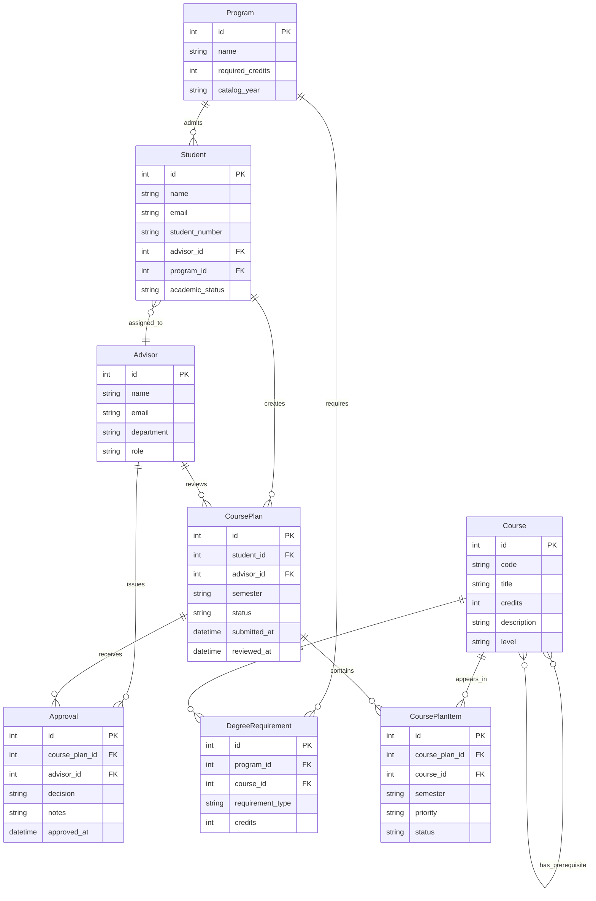

# COMP 3613 Assignment 1

Draft this file with the Guide. **Update it after every phase milestone** before you pause. The use-case diagram is a UML PNG at `docs/diagrams/use-case.png`, linked from this file as `diagrams/use-case.png` (path relative to `docs/report.md`). The model diagram is Mermaid. **Embed wireframe images** as `wireframes/<file>` (files live in `docs/wireframes/`).

Do not put your student ID in this file if you will commit it. The PDF cover adds your name and ID at export time.

## Assigned project
MyAdvisor

## Three workflows

### 1. Track Degree Progress (Student)

### 2. Plan Semester Courses (Student)

### 3. Approve Course Plan (Advisor/Administrator)

## Use case diagram

Phase 2 decisions: Track Degree Progress and Plan Semester Courses are independent use cases. Planning includes selecting courses, reviewing the plan, and submitting it for approval. Approve Course Plan belongs only to Advisor/Administrator and covers viewing submitted plans, approving or rejecting them, and the student seeing the decision. No use cases are shared across roles, and no additional use cases or include/extend relationships were added.

## Model diagram

Phase 4 revision: the wireframe confirms that courses can have prerequisites. Update this section again in Phase 5 if polish revises the model, and note what changed.

Assumption: the model centers on students, degree programs, courses, semester plans, and advisor approvals; each plan is a request for courses in a term, and every plan can be approved or rejected by an advisor.

## Wireframes

Phase 4 wireframe coverage: the updated image shows degree progress tracking, semester course planning, and course-plan approval/rejection. Course prerequisites appear on available courses, and the rejection dialog collects a reason. The post-decision flow remains: the student can view the advisor’s outcome on the submitted plan; approved plans remain locked for the current semester, while rejected plans return to the student for revision and resubmission.

<!-- student-build:wireframe-coverage
use_case: Track Degree Progress (Student)
image: docs/wireframes/MyAdvisorWireframe.png
covered: yes
-->

<!-- student-build:wireframe-coverage
use_case: Plan Semester Courses (Student)
image: docs/wireframes/MyAdvisorWireframe.png
covered: yes
-->

<!-- student-build:wireframe-coverage
use_case: Approve Course Plan (Advisor/Administrator)
image: docs/wireframes/MyAdvisorWireframe.png
covered: yes
-->

Phase 4 decisions: the model remains centered on Student, Advisor, Program, Course, CoursePlan, CoursePlanItem, DegreeRequirement, and Approval. Courses have a many-to-many prerequisite relationship, and `Approval.notes` stores the rejection reason. A rejected plan reopens for edits and resubmission on the same CoursePlan record; every review is retained as an Approval record. An approved plan is final.

## Theming

The app follows a calm academic brand: a deep slate base, green advisory accent, and warm gold highlight to signal graduation progress and approval status. The landing page uses a dark editorial hero treatment with a serif wordmark and soft glassy overlays, while the authenticated dashboards keep a lighter, familiar campus-planning palette for clarity.

Applied across the public screens and authenticated surfaces:

- Landing, login, and register pages inherit the same brand tokens and wordmark treatment.
- The sidebar and dashboard cards use a clean institutional palette with high contrast for academic content.
- Progress and approval badges use green for success and amber for draft / pending states without overwhelming the interface.
- Typography emphasizes an academic tone with a serif display face paired with modern sans-serif body text.

## Implementation notes

Phase 5 implementation follows the accepted MyAdvisor flows and the current ERD:

1. Track Degree Progress (Student): the dashboard displays required, completed, in-progress, and remaining credits. `CoursePlanItem.status` is the source of truth: completed and in-progress credits come from items with `completed` and `in_progress` status, and remaining credits are the program’s required credits minus both totals. Advisor approval authorizes a plan but does not mark its courses complete.
2. Plan Semester Courses (Student): a student selects a semester and course checkboxes, saves a draft, and submits the plan for advisor review.
3. Approve Course Plan (Advisor/Administrator): an advisor reviews submitted plans, enters notes, and either approves or rejects the submission.
4. Phase 5 polish: revising a rejected plan replaces its course items and resubmits the same CoursePlan ID and semester. Previous Approval records remain attached as decision history, and only submitted plans can be reviewed. Degree Progress and Plan Semester Courses use separate pages; the progress page lists each program requirement and marks it complete only when the student has a completed course item. The admin experience now has a dashboard queue and a separate per-plan review page. The queue includes all submitted plans, including those assigned to the default advisor rather than the administrator's own advisor record; decisions still retain the reviewing administrator. Local verification of this update is pending.

The current model remains centered on Student, Advisor, Program, Course, CoursePlan, CoursePlanItem, DegreeRequirement, and Approval. The main implementation revision was to add explicit relationship typing in the SQLModel definitions so the schema initializes cleanly with SQLModel and supports the course-plan data flow.

The user-facing build uses the layered architecture required by the project: thin routes call a service, which delegates to the MyAdvisor repository, and the repository persists the academic model objects. The public landing and auth screens were themed to match the MyAdvisor brand, and the authenticated dashboard is polished for a working degree-planning workflow instead of a starter template.

## Deployed app

Phase 6. Public Render URL (not localhost). Markers open this to mark the three workflows.

https://

## Logins

Every account a marker needs, including extra users you added. Starter accounts:

- bob / bobpass — regular user
- admin / adminpass — admin

## YouTube URL

## Session transcripts

Filled when the Guide builds the report: the agent writes each Guide chat to `docs/transcripts/<slug>.md` (Copilot Agent, Cursor, or OpenCode). `python manage.py report` packages them. Do not paste chats here during the build.

## Competency (student-judge)

Filled when the report is built. Guide runs student-judge, writes `docs/judge.md`, and export appends the scorecard here.

## Skill integrity

Filled by `python manage.py report`. Do not edit the course skills.
