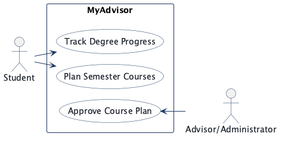
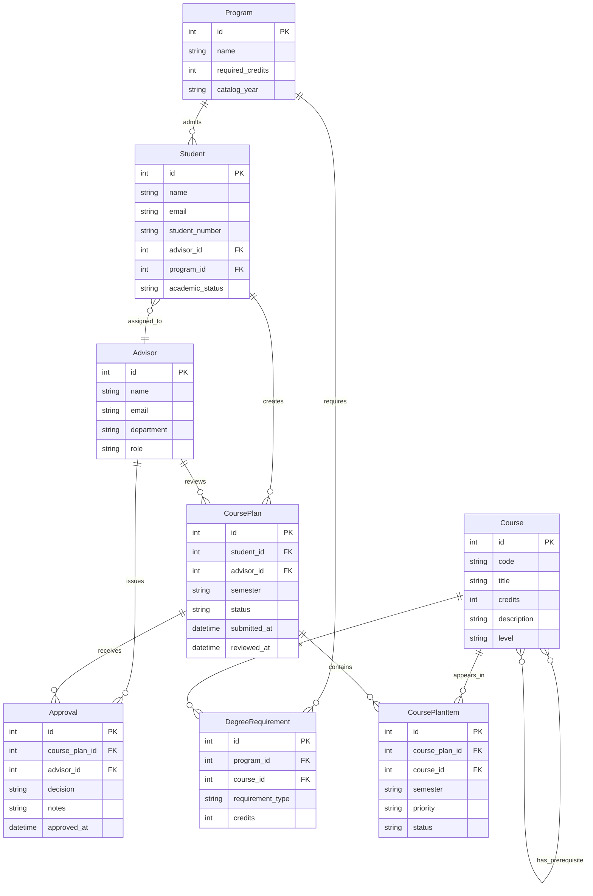
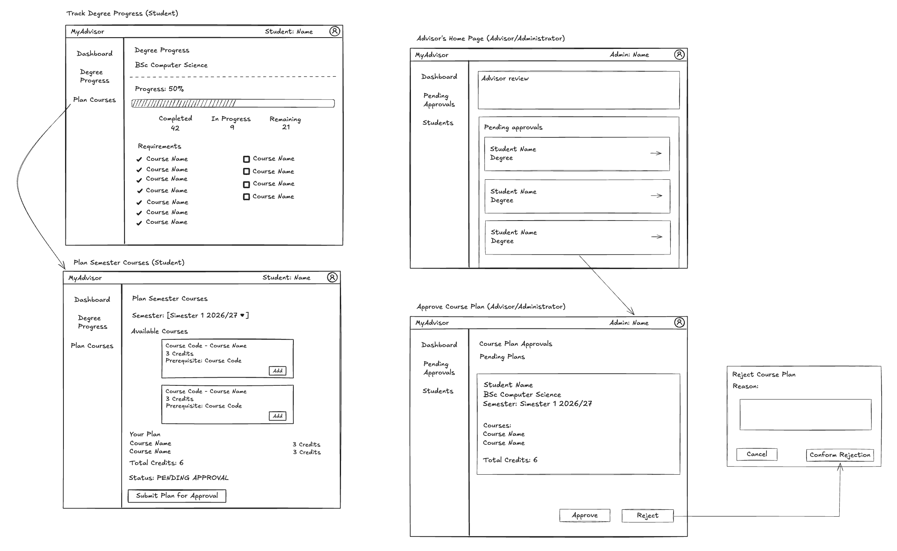

<!-- student-build:skill-integrity
status: pass
root: e84cd692d0b85eefe546385661958c27d07e8be6c5176a82012f68ccff5c8beb
expected_root: e84cd692d0b85eefe546385661958c27d07e8be6c5176a82012f68ccff5c8beb
mismatches: none
-->

# COMP 3613 Assignment 1

Draft this file with the Guide. **Update it after every phase milestone** before you pause. The use-case diagram is a UML PNG at `docs/diagrams/use-case.png`, linked from this file as `diagrams/use-case.png` (path relative to `docs/report.md`). The model diagram is Mermaid. **Embed wireframe images** as `wireframes/<file>` (files live in `docs/wireframes/`).

Do not put your student ID in this file if you will commit it. The PDF cover adds your name and ID at export time.

## Assigned project
MyAdvisor

## Three workflows

### 1. Track Degree Progress (Student)

### 2. Plan Semester Courses (Student)

### 3. Approve Course Plan (Advisor/Administrator)

## Use case diagram

Phase 2 decisions: Track Degree Progress and Plan Semester Courses are independent use cases. Planning includes selecting courses, reviewing the plan, and submitting it for approval. Approve Course Plan belongs only to Advisor/Administrator and covers viewing submitted plans, approving or rejecting them, and the student seeing the decision. No use cases are shared across roles, and no additional use cases or include/extend relationships were added.

## Model diagram

Phase 4 revision: the wireframe confirms that courses can have prerequisites. Update this section again in Phase 5 if polish revises the model, and note what changed.

Assumption: the model centers on students, degree programs, courses, semester plans, and advisor approvals; each plan is a request for courses in a term, and every plan can be approved or rejected by an advisor.

## Wireframes

Phase 4 wireframe coverage: the updated image shows degree progress tracking, semester course planning, and course-plan approval/rejection. Course prerequisites appear on available courses, and the rejection dialog collects a reason. The post-decision flow remains: the student can view the advisor’s outcome on the submitted plan; approved plans remain locked for the current semester, while rejected plans return to the student for revision and resubmission.

<!-- student-build:wireframe-coverage
use_case: Track Degree Progress (Student)
image: docs/wireframes/MyAdvisorWireframe.png
covered: yes
-->

<!-- student-build:wireframe-coverage
use_case: Plan Semester Courses (Student)
image: docs/wireframes/MyAdvisorWireframe.png
covered: yes
-->

<!-- student-build:wireframe-coverage
use_case: Approve Course Plan (Advisor/Administrator)
image: docs/wireframes/MyAdvisorWireframe.png
covered: yes
-->

Phase 4 decisions: the model remains centered on Student, Advisor, Program, Course, CoursePlan, CoursePlanItem, DegreeRequirement, and Approval. Courses have a many-to-many prerequisite relationship, and `Approval.notes` stores the rejection reason. A rejected plan reopens for edits and resubmission on the same CoursePlan record; every review is retained as an Approval record. An approved plan is final.

## Theming

The app follows a calm academic brand: a deep slate base, green advisory accent, and warm gold highlight to signal graduation progress and approval status. The landing page uses a dark editorial hero treatment with a serif wordmark and soft glassy overlays, while the authenticated dashboards keep a lighter, familiar campus-planning palette for clarity.

Applied across the public screens and authenticated surfaces:

- Landing, login, and register pages inherit the same brand tokens and wordmark treatment.
- The sidebar and dashboard cards use a clean institutional palette with high contrast for academic content.
- Progress and approval badges use green for success and amber for draft / pending states without overwhelming the interface.
- Typography emphasizes an academic tone with a serif display face paired with modern sans-serif body text.

## Implementation notes

Phase 5 implementation follows the accepted MyAdvisor flows and the current ERD:

1. Track Degree Progress (Student): the dashboard displays required, completed, in-progress, and remaining credits. `CoursePlanItem.status` is the source of truth: completed and in-progress credits come from items with `completed` and `in_progress` status, and remaining credits are the program’s required credits minus both totals. Advisor approval authorizes a plan but does not mark its courses complete.
2. Plan Semester Courses (Student): a student selects a semester and course checkboxes, saves a draft, and submits the plan for advisor review.
3. Approve Course Plan (Advisor/Administrator): an advisor reviews submitted plans, enters notes, and either approves or rejects the submission.
4. Phase 5 polish: revising a rejected plan replaces its course items and resubmits the same CoursePlan ID and semester. Previous Approval records remain attached as decision history, and only submitted plans can be reviewed. Degree Progress and Plan Semester Courses use separate pages; the progress page lists each program requirement and marks it complete only when the student has a completed course item. The admin experience now has a dashboard queue and a separate per-plan review page. The queue includes all submitted plans, including those assigned to the default advisor rather than the administrator's own advisor record; decisions still retain the reviewing administrator. The student reports that all three named workflows and this polish update work locally.

The current model remains centered on Student, Advisor, Program, Course, CoursePlan, CoursePlanItem, DegreeRequirement, and Approval. The main implementation revision was to add explicit relationship typing in the SQLModel definitions so the schema initializes cleanly with SQLModel and supports the course-plan data flow.

The user-facing build uses the layered architecture required by the project: thin routes call a service, which delegates to the MyAdvisor repository, and the repository persists the academic model objects. The public landing and auth screens were themed to match the MyAdvisor brand, and the authenticated dashboard is polished for a working degree-planning workflow instead of a starter template.

## Deployed app

Phase 6. Public Render URL (not localhost). Markers open this to mark the three workflows.

https://faststarter-6zf4.onrender.com

Deployed on Render in Oregon. The `faststarter-db` PostgreSQL 18 database and `faststarter` web service are available; the latest web-service deployment is live.

## Logins

Every account a marker needs, including extra users you added. Starter accounts:

- bob / bobpass — regular user
- admin / adminpass — admin

## YouTube URL

## Session transcripts

Filled when the Guide builds the report: the agent writes chat markdown into `docs/transcripts/`; `python manage.py report` packages them.

Guide packaged **15** chat(s) in `docs/transcripts/` (and `docs/transcripts.zip`).

Index: [docs/transcripts/INDEX.md](transcripts/INDEX.md)

- [`phase-1-workflows`](transcripts/phase-1-workflows.md)
- [`phase-2-use-cases`](transcripts/phase-2-use-cases.md)
- [`phase-3-model`](transcripts/phase-3-model.md)
- [`phase-4-prerequisites`](transcripts/phase-4-prerequisites.md)
- [`phase-4-wireframe-flow`](transcripts/phase-4-wireframe-flow.md)
- [`phase-5-admin-navigation`](transcripts/phase-5-admin-navigation.md)
- [`phase-5-admin-queue`](transcripts/phase-5-admin-queue.md)
- [`phase-5-initial-build`](transcripts/phase-5-initial-build.md)
- [`phase-5-progress-rule`](transcripts/phase-5-progress-rule.md)
- [`phase-5-same-plan-revision`](transcripts/phase-5-same-plan-revision.md)
- [`phase-5-separate-planning-page`](transcripts/phase-5-separate-planning-page.md)
- [`render-deployment`](transcripts/render-deployment.md)
- [`render-service-check`](transcripts/render-service-check.md)
- [`render-workspace-selection`](transcripts/render-workspace-selection.md)
- [`report-build`](transcripts/report-build.md)

## Competency (student-judge)

Filled by Guide from the student-judge run when this report was built.

**Judged at:** 2026-10-11
**Evidence pass:** re-read 14 project-matching native Copilot chats, one additional Render workspace chat included for completeness, and current `docs/report.md`, diagrams, and wireframe; prior judge ignored
**Student / session:** Daniel Goodridge / MyAdvisor
**Artifact:** Copilot Agent native chat records and current project artefacts
**Phases in evidence:** 1–6 (COMP 3613; Phase 5 polish, Phase 6 deploy)

### Totals
| | Count / value |
|--|--|
| Metrics on rubric | 12 (M1–M12) |
| N/A (excluded) | 0 |
| Metrics scored | 12 |
| Scoreable max | 12 × 4 |
| Awarded total | 40 / 48 |
| **Overall (avg of scored)** | **3.3 / 4** |
| Impression mark | 17 / 20 (derived; no Guide confidence value found) |

## Scorecard
| ID | Metric | Score / 4 | In avg | Evidence |
|----|--------|----------:|:------:|----------|
| M1 | Phase discipline | 3 | yes | Design artefacts preceded implementation; local polish preceded the Render deployment. Student asked, “am i ready for phase 6?” after the model-relationship fix and tests. |
| M2 | Problem framing | 3 | yes | Named three workflows and made clear include/extend and role boundaries. Phase 3 student entity/property/relationship decisions are not recoverable from the native chat record. |
| M3 | Decision ownership | 3 | yes | Owned roles, the submission handoff, status rules, and same-plan revision; model ownership is less clear because the Phase 3 record contains Guide messages only. |
| M4 | Artefact-before-code | 3 | yes | Phase 4 wireframe covers the named flows and informed prerequisite/rejection-note model details; Phase 5 changes followed those artefacts. |
| M5 | Verification habit | 4 | yes | Student reported all named workflows and polish worked locally. In deployment chat: “everything works so record the verification.” |
| M6 | Assignment fit | 3 | yes | Final routes use the service/repository structure and contain no inline SQL; changes track the named workflows and wireframe. |
| M7 | Slice explanation | 3 | yes | Student explained the progress calculation rule and rejected a new-plan approach: “implement same-plan revision, not creation of a new plan.” |
| M8 | Prompt quality | 3 | yes | Prompts identify concrete workflow mismatches, including the separate planning page, missing degree requirements, and admin queue behavior. |
| M9 | Response to pushback | 4 | yes | Continued iterating after the first build with progress semantics, page separation, same-plan revision, and admin queue/sidebar refinements. |
| M10 | Integrity | 4 | yes | No paste-back or other laundering flags in the native chats; `python3 manage.py skills-verify` passed and the protected course files match the lock. |
| M11 | Provenance continuity | 3 | yes | Implementation and polish remain tied to MyAdvisor’s three workflows, ERD, and student wireframe throughout the project chats. |
| M12 | Sincerity trajectory | 4 | yes | No suspicion blocks or spiral were recorded across the 14 native project chats; no suspicion protocol was needed. |

## Strengths
- The student named three concrete workflows and kept them role-specific. They explicitly kept planning and degree tracking independent and kept plan submission inside the planning workflow rather than inventing a fourth use case.
- The student made meaningful workflow and business-rule decisions during implementation: course-item status is the progress source of truth, and a rejected plan should be revised/resubmitted as the same plan.
- Phase 5 continued beyond the first build. The student requested wireframe-aligned page and admin-queue changes, reported local workflow success, and then proceeded to deployment.
- The final application routes delegate persistence through services/repositories; no inline SQL or `select`/`db.exec` in routers was found in the inspected routes.

## Gaps
- The Phase 3 native record has no student-authored turns. The Guide says it drafted the model from the assignment brief, so the report’s ERD cannot be credited as demonstrated student ownership of entities, properties, or relationship choices. This is an evidence/Guide-process gap, not evidence that the student refused a question.

## Phase gate status
| Phase | Status | Note |
|-------|--------|------|
| 1 | met | Three named MyAdvisor workflows are in the student’s words. |
| 2 | met | Student steered independent use cases, role associations, and the submission handoff. |
| 3 | partial | Model artefact exists, but the native Phase 3 chat contains only Guide-authored messages and states that the model was drafted from the brief. |
| 4 | met | Student-created wireframe is embedded and coverage is recorded for all three workflows; follow-up notes cover prerequisites and decision/revision behavior. |
| 5 | met | Themed implementation was followed by student-directed UI/workflow refinements and local verification; the report records that all three workflows work. |
| 6 | met | Public Render URL and marker logins are present in the report; deployment verification was recorded. |

## Recommended next practice
- Review the current ERD and explicitly confirm or revise its entities, properties, and relationship cardinalities, especially CoursePlan/Approval and the course-prerequisite relationship. The Phase 3 chat does not preserve the student’s modeling decisions.

## Integrity note
- Clean. Skill integrity passed; all protected skill files match `.agents/skills.lock.json`.

## Provenance flags
- Phase 3 model ownership is not verifiable from its assistant-only native record. No other red flags found.

## Sincerity log summary
- Blocks found: 0 | max round: N/A | min/mean/final confidence: N/A | trend: N/A | cleared: not triggered

## Skips
- Skips: 0/3 used (as recorded in the Phase 4 report notes).

## Skill integrity

Course skills are hashed at export and compared to `.agents/skills.lock.json`. Do not edit `.agents/skills/`, `.cursor/skills/`, or `AGENTS.md`.

- Status: **pass**
- Root: `e84cd692d0b85eefe546385661958c27d07e8be6c5176a82012f68ccff5c8beb`
- none
